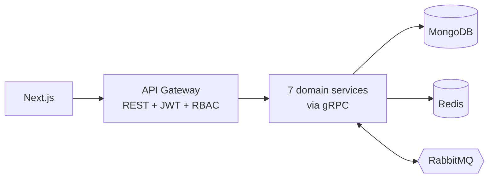

# E-Procurement Platform

Platform pengadaan barang/jasa berbasis microservices: manajemen vendor,
tender/RFQ, penawaran harga, purchase order, approval workflow, audit log, dan
reporting — dalam satu alur yang terekam jejaknya.

**Stack:** Golang · gRPC + Protobuf · REST · MongoDB · Redis · RabbitMQ ·
Next.js · TypeScript · Tailwind CSS · Docker · GitHub Actions

## Fitur (MVP)

- **Vendor** — CRUD supplier, status aktif/nonaktif, pencarian & filter
- **Tender / RFQ** — buat, publish, tutup (termasuk auto-close saat `close_at` lewat)
- **Bid** — vendor mengirim penawaran, perbandingan harga antar vendor
- **Purchase Order** — PO dibuat dari bid terpilih, status machine lengkap
- **Approval** — PO di atas threshold otomatis masuk approval, dengan history keputusan
- **Audit log** — append-only, mencatat actor/action/entity/before-after
- **Reporting** — laporan PO per vendor, tender, dan approval + export CSV

## Arsitektur

Diagram komponen, alasan pemilihan microservices/MongoDB/RabbitMQ, dan matriks
role ada di [`docs/architecture.md`](docs/architecture.md).



Data model dan index: [`docs/data-model.md`](docs/data-model.md).
Katalog event: [`docs/events.md`](docs/events.md).
Rencana pengerjaan 10 fase: [`docs/plan.md`](docs/plan.md).

## Menjalankan

Butuh Go 1.26+, Node 24+, pnpm, Docker.

```bash
cp .env.example .env          # sesuaikan bila perlu

make infra-up                 # Mongo + Redis + RabbitMQ
make run SERVICE=vendor-service   # jalankan satu service (terminal terpisah)
make up                       # atau seluruh stack via Docker Compose
```

Frontend:

```bash
cd web && pnpm install && pnpm dev   # http://localhost:3000
```

Perintah lain: `make help`.

## Struktur repositori

```
cmd/            entrypoint setiap service
internal/       kode domain per service (model, repository, service, handler)
pkg/            library bersama: config, logger, db, cache, broker, auth, httpx, middleware, validator
proto/          definisi gRPC (sumber kebenaran kontrak antar service)
proto/gen/      hasil generate (jangan diedit manual)
web/            Next.js + TypeScript + Tailwind
deploy/docker/  Dockerfile + docker-compose
deploy/k8s/     manifest Kubernetes (opsional)
docs/           arsitektur, data model, event, rencana
scripts/        alat bantu (seed, migrasi)
```

## Status

- [x] Fase 0 — perencanaan, ruang lingkup, aktor, arsitektur
- [x] Fase 1 — repository, tooling, Docker, CI, linter
- [ ] Fase 2 — domain & data model final, protobuf
- [ ] Fase 3 — service inti
- [ ] Fase 4 — frontend
- [ ] Fase 5 — integrasi & workflow otomatis
- [ ] Fase 6 — testing & QA
- [ ] Fase 7 — CI/CD & deployment
- [ ] Fase 8 — dokumentasi & portofolio
- [ ] Fase 9 — AI-assisted workflow
- [ ] Fase 10 — finalisasi

## AI-assisted workflow

Bagian ini diisi selama pengerjaan (Fase 9): prompt yang dipakai, apa yang
divalidasi manual, dan bagaimana hasil AI diuji. Aturannya satu: **tidak ada
kode hasil AI yang masuk tanpa review dan test yang lulus.**

## Lisensi

Belum ditentukan.
