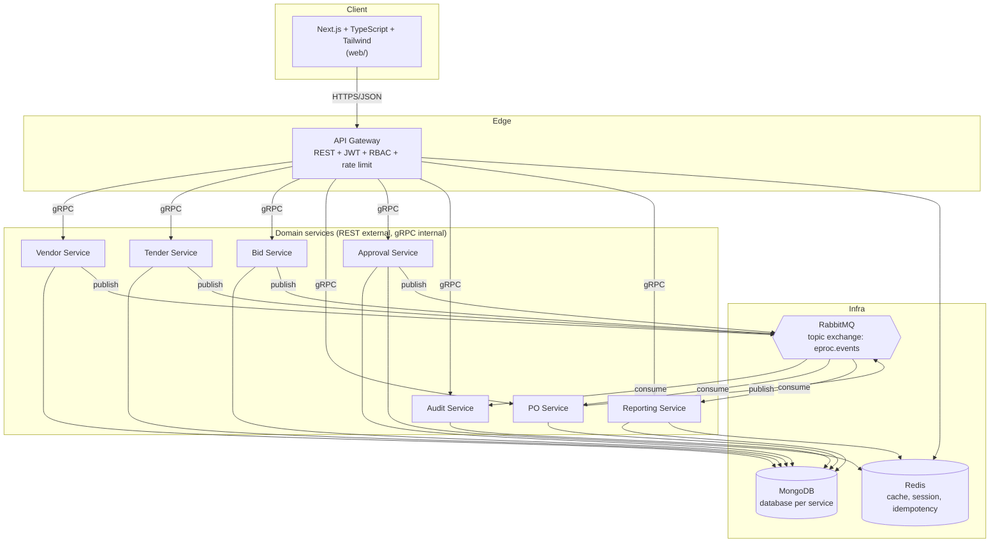

# Arsitektur E-Procurement Platform

## Ringkasan

Platform e-procurement dengan arsitektur microservices. Setiap domain punya
service sendiri, database sendiri (MongoDB), berkomunikasi lewat gRPC untuk
panggilan sinkron dan RabbitMQ untuk event asinkron. Frontend Next.js berbicara
ke klien hanya melalui API Gateway.

## Masalah yang diselesaikan

Proses pengadaan manual (email, spreadsheet) tidak punya jejak audit yang bisa
dipercaya, sulit membandingkan penawaran vendor secara konsisten, dan approval
sering macet tanpa terlihat siapa yang menahan. Platform ini menyatukan
vendor, tender/RFQ, penawaran, PO, approval, dan audit log dalam satu alur yang
terekam.

## Ruang lingkup MVP

- Manajemen vendor/supplier
- Tender / RFQ
- Penawaran (bid) & perbandingan harga
- Purchase Order
- Approval workflow
- Audit log
- Reporting sederhana

## Aktor dan role

| Role | Kode | Tanggung jawab utama |
| --- | --- | --- |
| Admin | `admin` | Kelola user, konfigurasi, akses penuh |
| Procurement Officer | `procurement_officer` | Kelola vendor & tender, buat PO |
| Approver / Manager | `approver` | Setujui/tolak PO di atas threshold |
| Vendor / Supplier | `vendor` | Lihat tender, kirim penawaran |

Matriks izinnya ada di `pkg/auth/auth.go` (`rolePermissions`) — default menolak,
jadi setiap izin baru harus ditambahkan secara eksplisit.

## Diagram komponen

## Kenapa microservices

Batas domainnya jelas (vendor, tender, bid, PO, approval), dan tiap batas punya
pola beban berbeda: pencarian vendor itu read-heavy, sedangkan approval dan PO
itu write-heavy dengan aturan bisnis. Memisahkannya membuat aturan approval
bisa berubah tanpa menyentuh katalog vendor, dan tiap service bisa diskalakan
sendiri. Untuk MVP ini, memisahkan juga memaksa kontrak antar-domain menjadi
eksplisit (proto + event), yang jadi bahan dokumentasi dan latihan desain.

## Kenapa MongoDB

Dokumen pengadaan itu bersarang dan bentuknya bervariasi: satu tender berisi
daftar item, satu bid berisi daftar harga per item, satu PO berisi baris pesanan
yang bentuknya hampir sama dengan item bid. Model dokumen membuatnya jadi satu
read, tanpa join, dan index-nya bisa ditambah per pola query tanpa migrasi
skema yang kaku. Konsekuensinya: transaksi lintas entitas harus ditangani di
level aplikasi (saga/event), bukan mengandalkan constraint foreign key — itu
alasan utama event bus ada di desain ini.

## Kenapa RabbitMQ

Beberapa aksi harus menyebar tanpa memblokir pengguna: setelah PO dibuat, audit
service harus mencatatnya dan reporting harus memperbarui agregat. Topic
exchange memberi routing key hierarkis (`po.approved`, `tender.published`) tanpa
menambah konfigurasi di sisi publisher, dan durable queue membuat pesan selamat
saat consumer restart. Retry safety ditangani lewat idempotency key di Redis.

## Catatan keamanan

- Token JWT HS256, TTL default 12 jam, sesi bisa dicabut lewat Redis.
- Otorisasi di level izin (`vendor:read`, `po:write`, …), bukan cek role ad-hoc
  di handler.
- Rate limit per IP memakai counter Redis.
- Body request dibatasi 1 MiB dan field tak dikenal ditolak (`DisallowUnknownFields`).
