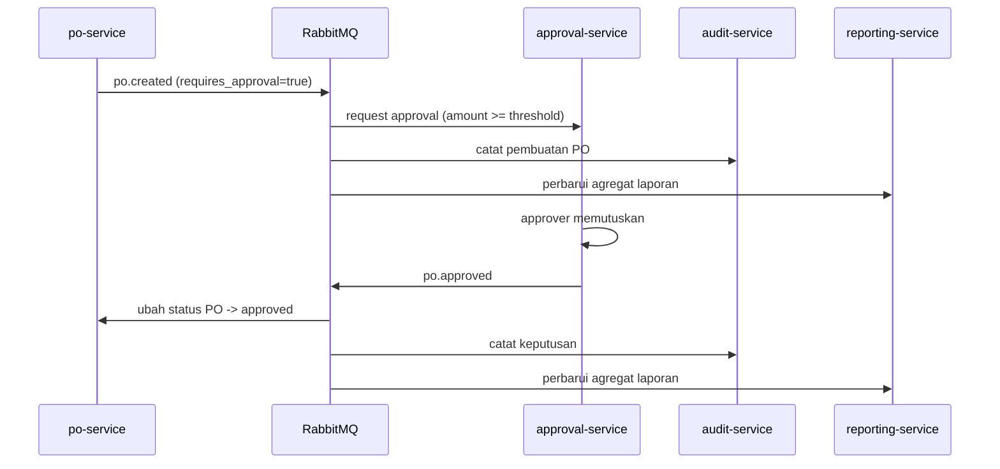

# Katalog event

Semua event dipublikasikan ke satu topic exchange **`eproc.events`** dengan
routing key = nama event. Envelope-nya seragam (`pkg/broker.Event`):

```json
{
  "id": "6f1c2f7e-...",
  "name": "po.approved",
  "tenant_id": "t-1",
  "actor_id": "u-42",
  "occurred_at": "2026-10-15T04:30:00Z",
  "payload": { "...": "..." }
}
```

| Event | Publisher | Consumer | Isi payload inti |
| --- | --- | --- | --- |
| `vendor.created` | vendor-service | audit-service | `vendor_id`, `code`, `name`, `status` |
| `vendor.updated` | vendor-service | audit-service | `vendor_id`, `changed_fields` |
| `tender.published` | tender-service | audit-service, bid-service | `tender_id`, `code`, `close_at`, `invited_vendor_ids` |
| `tender.closed` | tender-service | audit-service, bid-service | `tender_id`, `closed_by` |
| `bid.submitted` | bid-service | audit-service | `bid_id`, `tender_id`, `vendor_id`, `total` |
| `po.created` | po-service | approval-service, audit-service, reporting-service | `po_id`, `number`, `vendor_id`, `total`, `requires_approval` |
| `po.approved` | approval-service (via po-service status) | po-service, audit-service, reporting-service | `po_id`, `approval_id`, `amount` |
| `po.rejected` | approval-service | po-service, audit-service | `po_id`, `approval_id`, `comment` |
| `po.closed` | po-service | audit-service, reporting-service | `po_id`, `closed_by` |
| `audit.recorded` | audit-service | — | `audit_id`, `action`, `entity_type`, `entity_id` |

## Aturan konsumsi

- Queue bersifat durable dan dinamai per consumer: `<service>.<event-family>`
  (contoh: `audit.events`, `po.events`, `reporting.events`).
- Handler yang gagal melakukan `Nack` **tanpa requeue** supaya pesan rusak tidak
  berputar tanpa akhir. Pesan yang gagal dicatat di log dengan `event_id`.
- Operasi yang dipicu event harus idempoten: consumer memakai `idem:<event_id>`
  di Redis agar pengiriman ulang tidak menggandakan efek.

## Alur yang membentuk workflow



Tender otomatis ditutup ketika `close_at` lewat: scheduler di tender-service
memindai `{status: published, close_at < now}` lalu menerbitkan `tender.closed`.
